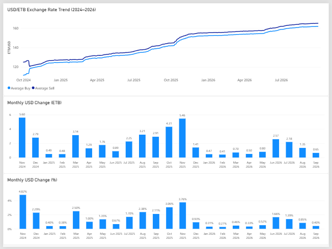
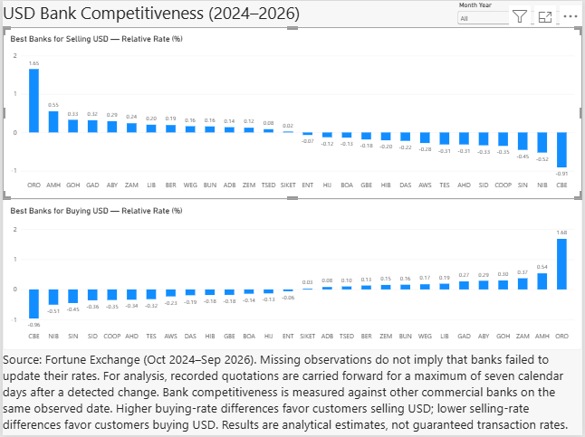

# Ethiopian USD/ETB Exchange Rate & Bank Competitiveness Analysis

**PostgreSQL · SQL · Power BI · DAX | Historical analysis: October 2024–September 2026**

An end-to-end analytical portfolio project examining how the Ethiopian birr price of the US dollar changed over time and how Ethiopian commercial banks' **published USD cash buying and selling quotations** compared with their peers.

The goal is to answer two questions:

1. **Market trend:** How did USD/ETB move over the two-year observation period, including month-to-month changes in ETB and percent?
2. **Bank competitiveness:** Which banks historically offered relatively higher USD *buying* quotes (better for a customer **selling USD**) or lower USD *selling* quotes (better for a customer **buying USD**)?

> **Interpretation:** These are historical published cash quotations from a third-party archive, not executed transactions or the NBE's volume-weighted reference rate. Bank comparisons are conditional on the project's **seven-day analytical freshness rule**; they are not a recommendation of where a customer can transact today.

## Dashboard preview

### 1. USD/ETB market overview



The report shows a two-year historical trend and monthly changes in the **average cash buying rate**. The monthly ETB and percent charts compare each month with the previous month, rather than averaging all two years into a single KPI.

### 2. USD bank competitiveness



Two comparisons, each with a **Month Year** slicer:

- **Selling USD to a bank:** Higher cash buying quote relative to peers is better for the customer.
- **Buying USD from a bank:** Lower cash selling quote relative to peers is better for the customer.

The default view compares each bank across the full period; selecting a month recalculates rankings using only that month's valid observations.

*Images show the finalized Power BI pages. They are raster screenshots, so a higher-resolution capture may improve legibility on larger displays.*

## Findings from the validated model

| Finding | Result |
| --- | ---: |
| Average cash buying quotation, October 2024 | **116.0468 ETB/USD** |
| Average cash buying quotation, September 2026 | **161.6597 ETB/USD** |
| November 2024 change in monthly average buy | **+5.60 ETB (+4.82%)** |
| November 2025 change in monthly average buy | **+5.46 ETB (+3.76%)** |
| Highest full-period *relative cash buying quote*: Oromia International Bank (`ORO`) | **+1.65% vs same-day peers** |
| Lowest full-period *relative cash selling quote*: Commercial Bank of Ethiopia (`CBE`) | **−0.96% vs same-day peers** |

The final two percentages average the bank's **daily peer-relative comparisons**, not the bank's absolute ETB exchange rate over two years. They indicate performance on dates when a bank had a quotation valid under the defined methodology; availability and transaction execution are **not verified**.

## Data and model

| Measure | Validated count |
| --- | ---: |
| Archived source rows (USD, EUR, GBP, AED) | 55,381 |
| USD fact rows analyzed | 14,243 |
| Date dimension dates | 730 |
| Dates with USD observations | 605 |
| Commercial banks represented in the comparisons | 28 |
| Detected cash quote events, including 23 assumed opening-baseline quotes | 6,468 |
| Mean banks with seven-day-valid quotations per observed date | 20.4 |
| Min / max banks contributing to a daily market average | 9 / 27 |

**Original data source:** [Addis Fortune's exchange-rate archive](https://exchange.addisfortune.news/currencies). Historical bank-level snapshots for October 1, 2024–September 30, 2026 were collected into a local archive. Only USD is used in the analytical fact table; the original four-currency staging data was retained separately.

**Archive coverage limitation:** Fortune Exchange contains USD observations on 605 of 730 calendar dates; **125 dates are missing** (104 Sundays and 21 other dates). Missing archive records **do not establish that banks failed to update their rates**. A bank may have changed its quote on an unobserved date or republished an identical rate; neither can be reliably inferred from this third-party source.

**Source redistribution:** The original archived CSV is **not included in this repository**, pending confirmation that redistribution is permitted. The SQL scripts require an independently obtained, appropriately authorized copy of the source data.

## Seven-day analytical carry-forward rule — why it matters

The Fortune Exchange archive sometimes repeats the same bank quotation for long periods. However, the archive does not provide a complete record of each bank's publication history. **No detected change does not mean the bank made no update:** a change may have occurred on a missing archive date, or the bank may have republished identical rates.

For this reason, the seven-day interval is an **analytical carry-forward assumption**, not evidence of a bank's actual quotation age, validity or update frequency.

A bank sometimes displays an unchanged quote for long periods. Averaging **only banks that changed their quote that day** can misrepresent the wider recently quoted market. For example, on **May 23, 2025**, only one bank had a newly detected change, but **16** commercial banks had rates within our seven-day analytical window.

We therefore:

1. Detect an event when a bank's valid cash buy **or** cash sell quote differs from its preceding valid observation.
2. Treat the **23 commercial-bank quotes on October 1, 2024** as *assumed starting-baseline events*. First appearances after that date are **not** automatically treated as events.
3. Consider each event valid for **seven calendar dates including the event day** (quote age **0–6 days**), unless superseded by a new quote change.
4. Do **not** renew validity merely because the same rate appears again, and never fill dates absent from the original archive.
5. Apply the same resulting set of eligible bank-date quotes to both the market trend and peer comparisons. Exclude NBE and DBE from commercial-bank peer calculations.

These rules are analytical modeling choices, **not a claim about when a bank actually updated, how long its quote remained valid, or whether a transaction could be executed**. Updates on dates missing from Fortune Exchange cannot be observed. Full formulas, choices and caveats are described in [Methodology](docs/methodology.md).

## Tools and skills demonstrated

- **PostgreSQL / SQL:** staging and dimensional modeling, date generation, constraints, UPSERTs, window functions (`LAG`, `LEAD`), CTEs, views, conditional aggregation and validation queries.
- **Power BI / DAX:** SQL import, model relationships, daily line charts, monthly change calculations, bank comparisons, slicers and report layout.
- **Analytical judgment:** detected and corrected the one-bank market-average anomaly; tested coverage and freshness rather than treating repeated rates as new information.
- **Reproducibility:** independent rebuild in a separate PostgreSQL database, followed by **21 of 21 expected-value checks passed** and additional invariants checked.

## Repository contents

```text
ethiopia-usd-exchange-rate-analysis/
├── README.md
├── sql/
│   ├── ethiopia_fx_final_master.sql
│   └── ethiopia_fx_final_validation.sql
├── docs/
│   ├── methodology.md
│   └── rebuilding_and_validation.md
├── screenshots/
│   ├── usd_etb_market_overview.png
│   └── bank_competitiveness.png
└── data/
    └── README.md
```

## Reproduce the model

**Requirements:** PostgreSQL (tested with the user's PostgreSQL 18.6 `psql` environment), a PostgreSQL GUI such as DBeaver for CSV import, and a licensed/authorized copy of the archived CSV with the expected columns.

1. Create a new PostgreSQL database (e.g. `ethiopia_fx_rebuild_test`).
2. Create a staging table `raw_exchange_rates` with the schema documented in [Rebuilding and Validation](docs/rebuilding_and_validation.md).
3. Import `all_exchange_rates.csv` and **map the source header `date` to database column `rate_date`**. Verify 55,381 rows, 14,243 USD rows and 605 distinct dates.
4. Run `sql/ethiopia_fx_final_master.sql` with PostgreSQL `psql` using `\i` and `\set ON_ERROR_STOP on` (recommended; the project encountered DBeaver script-splitting issues). Do not run this on a production database without a backup.
5. Run `sql/ethiopia_fx_final_validation.sql`; verify **21/21 PASS** and zero invalid ages/duplicates/noncommercial rows.
6. Connect Power BI to `vw_daily_usd_market` and `vw_bank_quote_event_vs_peer`, together with `dim_date` and `dim_bank`; configure the date/bank relationships and recreate the visuals described in the [methodology](docs/methodology.md).

Detailed commands and validation targets are in [Rebuilding and Validation](docs/rebuilding_and_validation.md).

## Limitations

- **Cash quotations, not transaction records:** prices may be indicative, negotiable, or subject to charges, transaction restrictions and availability.
- **Seven-day carry-forward is an analytical choice:** it starts at *detected changes in the archive*, not verified bank publication times. Repeated identical values do not renew the window. Results may change if a different window or source is used.
- **Equal weighting:** daily market averages are unweighted across eligible banks; monthly averages are unweighted across observed dates; historical bank scores are unweighted across eligible bank-days. This is **not** the official NBE volume-weighted exchange rate.
- **Incomplete third-party coverage:** 605 observed USD dates in a 730-day range (125 missing, including 104 Sundays). Missing observations do **not** prove banks failed to issue or update quotes. Missing dates are not imputed.
- **Unequal bank representation:** a full-period bank score describes its available eligible observations rather than identical daily participation by every bank.
- **No live recommendations:** the analysis ends September 30, 2026 and should not be used to choose a bank for a present-day transaction.

See also the [National Bank of Ethiopia FX guidance](https://nbe.gov.et/fx/) for the distinction between posted bank rates, negotiated transaction rates and NBE's indicative, volume-weighted rate.

## Development note

This project was developed with AI assistance for SQL implementation and troubleshooting. The analytical questions, model decisions, database execution, consistency checks and report interpretation were iteratively reviewed and verified against the archived data. The project demonstrates the documented workflow and results; it does not claim independent authorship of every line of code.